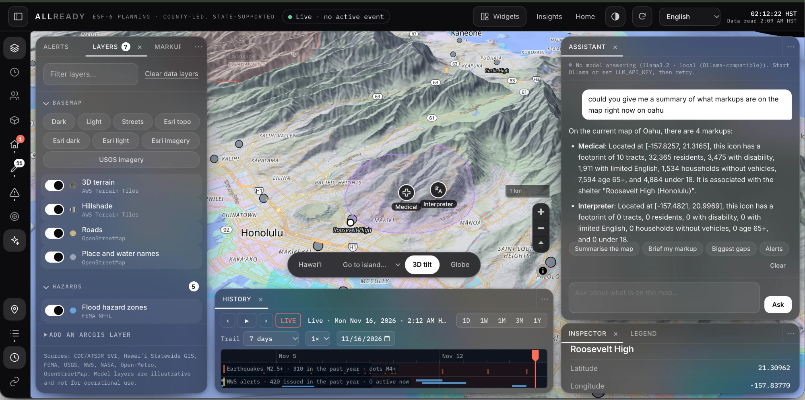

# AllReady

**Access and functional needs (AFN) mass-care planning for Hawaiʻi.**
HAIC 2026 · AI-Developed Planning and Improvement Challenge · Department of Human Services, “Enhancing ESF-6 Planning through AI-Supported Insight”.



*The planning map: Layers and Alerts on the left, the History timeline below, and the Assistant and Inspector on the right. A what-if wildfire scenario and the planner's markup are drawn on the map, and the assistant is summarising them.*

> AllReady issues no alerts. In an emergency follow official county announcements and call 911.

Team: `aws_ec2_instance` · Licence: [MIT](LICENSE)

DHS asked one question: *how do we make sure the people who need the most help are already in the plan before the disaster?* The information exists, but it is scattered across counties, agencies and federal programs. AllReady reads those public sources live and puts them on one screen: where residents with access and functional needs live, what each hazard would require, what each county's own shelter records can and cannot cover, and who decides what, when. An AI assistant running on the planner's own machine reads the same screen and answers in plain language.

| | |
|---|---|
| **Plan** | [docs/PLAN.md](docs/PLAN.md): the framework, DHS's three goals and how each is measured |
| **Architecture** | [docs/ARCHITECTURE.md](docs/ARCHITECTURE.md): how it is built and why |
| **Security and privacy** | [docs/SECURITY.md](docs/SECURITY.md): controls, threat model, and the laws and standards it maps to |
| **Accessibility** | [docs/ACCESSIBILITY.md](docs/ACCESSIBILITY.md): what was checked and what is still open |

## Six pages, one workflow

| Page | The question it answers | What a planner does there |
|---|---|---|
| **Home** (`home.html`) | What is this and what is true today? | Live figures per island, read from the feeds as the page opens. |
| **Live map** (`index.html`) | What is happening now, and where? | Live NWS event, the model's 3-day warning outlook, AFN census tracts, shelters, hazard layers that explain themselves when clicked, a year of alert history, map markup, and the assistant. |
| **Event planner** (`scenarios.html`) | If this hazard hits this county, who needs what? | A 7-day warning outlook from a trained model; a county × hazard grid; residents inside each published hazard zone; needs across all five CMIST areas; supply and gaps with *who to call*; shelter demand phase by phase against capacity; decision points; a printable brief. |
| **Coordination** (`roles.html`) | Who meets each need, and how are residents told? | Roles matrix, communication pathways, and a register of partner commitments that the Event planner counts against each gap. |
| **Insights** (`insights.html`) | So what, across the state? | A dashboard of live metric tiles, county data readiness, gaps, an AI summary and the check against past events. |
| **Data health** (`method.html`) | Can I trust this number? | Every source checked live from the browser, coverage against the DHS goals, the past-events check, the warning-outlook model's test scores, and every planning factor. |

## For judges: five minutes

Every page opens with a short guide (what the page is for, and how to use it in four steps), and the **?** button in the top bar explains every term (AFN, CMIST, SVI, emPOWER, ESF-6…).

1. **Home.** Every figure under each island is read live; nothing is typed in. The three cards are the three parts of the DHS framework, each linked to the page that does it.
2. **Event planner.** Pick a county and hazard, or **start from a past event** (Hurricane Lane 2018, the 2023 Maui wildfires) to rehearse a repeat at the turnout counted then. The grid shows people likely to need a public shelter for every county and hazard. Pick *Maui · Wildfire*: residents inside the State's High fire-risk areas, the five CMIST needs, the gaps, and for every unknown the organisation to call. Switch intensity to *Near miss*, which is calibrated to turnout actually counted in a past Hawaiʻi event. *Print brief* gives one page. The **7-day warning outlook** on the right is a trained model: click any percentage to rehearse that county and hazard.
3. **Live map.** The Event planner and the Live map share one what-if: the map opens on the same county and hazard and draws the census tracts with residents inside that hazard's zone, and a change on either page reaches the other, even in another tab. The chip says **Live**: the event is whatever the National Weather Service has in force. With nothing in force the app calculates no needs and offers to rehearse one instead. *Open on the live map* from the Event planner lands on that county with the event clock open.
4. Ask the **Assistant** *“Summarise the map”*, or in the Event planner *“Unknowns and who confirms them”*. It runs on the planner's own machine and uses only the figures on screen.
5. **Data health.** Every source is checked live from your browser, with coverage against each DHS goal, the past-events check, and how the warning outlook scored on 2025–2026 days it never saw.

## What it does

| DHS asked for | Where | What you get |
|---|---|---|
| **1. Population mapping** | Event planner, Live map, Data health | All 432 populated 2020 census tracts, with the residents inside each hazard's published zone (tsunami evacuation zone, High fire-risk area, FEMA flood zone, whole island for hurricane) from 2020 Census blocks, scored on CMIST measures (CDC/ATSDR SVI 2022) and HHS emPOWER, beside each county's own shelter records. |
| **2. Resource identification** | Event planner, Insights | A per-hazard model turns residents in the zone into shelter demand (with a low–high range and three intensities) and then into space, accessible space, power, water, meals, dialysis, interpreters, transport and pet capacity, set against what counties publish and partners pledge. A gap that cannot be computed is shown as **ask** with the organisation that holds the answer, never guessed. |
| **Faster path from a forecast to a plan** | Event planner, Live map, Data health | A machine-learning outlook of the warnings NWS is likely to issue in each county over the next 7 days, trained on every NWS Honolulu warning since 2022 and tested on days it never saw; one click turns a likely warning into a rehearsed county plan. |
| **3. Coordinated response** | Event planner, Coordination, Live map | County-led, State-supported decision points with owner, trigger, channel and languages; a roles matrix; communication pathways; a partner commitment register; shapes, icons and points of contact on the map; printable briefs; an assistant grounded in the on-screen figures. |

### Live by default

Shelter status and alerts are re-read every five minutes. Every source, including census tracts and emPOWER, is re-queried every thirty minutes and on the refresh button. A new county or federal release appears without rebuilding or redeploying anything, and each panel shows when its feeds were last read. Supply that no feed publishes (cots, water, generators) can be entered by hand and is always tagged *manual*.

### Checked against past events

DHS goal 2 asks for estimates validated against past events. AllReady runs its live shelter formula, untuned, over the area each past event affected and shows the result beside the published shelter count, with a link to the source ([`src/backtest.js`](src/backtest.js)). As computed on 16 Nov 2026:

| Event | Published in shelters | Model likely (range) | Observed / assumed turnout |
|---|---:|---:|---:|
| Hurricane Lane 2018, Honolulu | 1,114 | 70,707 (28,283–141,414) | 0.11% / 7.0% |
| Hurricane Lane 2018, Maui County | 381 | 11,534 (4,614–23,068) | 0.23% / 7.0% |
| Hurricane Lane 2018, Kauaʻi | 17 | 5,146 (2,058–10,292) | 0.023% / 7.0% |
| Hurricane Lane 2018, Hawaiʻi County | 14 | 14,151 (5,660–28,302) | 0.007% / 7.0% |
| Maui wildfires 2023 | 1,418 | 9,391 (3,756–18,782) | 3.2% / 21% |

Honest reading: no count falls inside the range, and every miss is on the high side. The hurricane rate describes a direct hit and Lane passed offshore, so those rows size a direct hit; they do not predict a near miss. The factors were not changed after seeing these results. The margin that counts as “reasonable”, and which events to score, are for DHS and the counties to agree. The table gives them observed turnout rates to start from.

## Set it up

You need **Node.js 20.12 or newer** and, for the assistant, **Ollama**. Everything else installs with one command. No accounts and no API keys are needed.

### 1. Install the prerequisites

| | macOS | Windows | Linux |
|---|---|---|---|
| Node.js | [nodejs.org](https://nodejs.org) installer, or `brew install node` | [nodejs.org](https://nodejs.org) installer | your package manager, or [nodejs.org](https://nodejs.org) |
| Ollama | [ollama.com/download](https://ollama.com/download) | [ollama.com/download](https://ollama.com/download) | `curl -fsSL https://ollama.com/install.sh \| sh` |

Check both:

```bash
node --version
```

```bash
ollama --version
```

### 2. Get the model (one time, about 2 GB)

```bash
ollama pull llama3.2
```

Ollama runs in the background after it is installed. If `ollama list` cannot connect, start it:

```bash
ollama serve
```

### 3. Install and configure AllReady

```bash
npm install
```

```bash
cp .env.example .env
```

The defaults in `.env` already point at Ollama on this machine. `.env` is git-ignored and must never be committed.

### 4. Run

```bash
npm run dev
```

Open <http://localhost:5173>. The Assistant panel on the map should read **Connected · llama3.2 · Ollama on this machine**. The first question after start-up takes longest while the model reads its instructions; follow-up questions reuse that work.

### 5. Run the production build (with security headers)

```bash
npm run build
```

```bash
npm start
```

Open <http://localhost:8080>.

### 6. Run the tests

```bash
npm test
```

Twenty-one checks cover input validation, size limits, rate limiting, cross-origin refusal, path traversal and hidden files, security headers, both assistant protocols, the warning-outlook model (its inputs match its weights, its scores are probabilities, and they move the right way with the weather), resilience (a feed that never answers is cut off, and a county whose feed failed reads as missing, never as zero), and imported markup (only well-formed items survive).

### Configuration (`.env`)

| Variable | Default | Meaning |
|---|---|---|
| `LLM_BASE_URL` | `http://localhost:11434/v1` | Where the model lives. Ollama by default. |
| `LLM_MODEL` | `llama3.2` | Model name. |
| `LLM_API_KEY` | empty | Only for a hosted provider. Stays on the server. |
| `LLM_API` | `auto` | `auto` detects a local Ollama and uses its native API; `openai` or `ollama` force one. |
| `LLM_NUM_CTX` | `8192` | Largest context window asked of Ollama. 4096 is used when the prompt fits. |
| `CHAT_RATE_PER_MIN` | `20` | Assistant requests per visitor per minute. |
| `ALLOWED_ORIGINS` | empty | Extra origins allowed to call `/api`. Empty means same-origin only. |
| `TRUST_PROXY` | empty | Set to `1` only behind your own reverse proxy. |
| `PORT` | `8080` | Port for `npm start`. |

### If something does not work

| You see | Do this |
|---|---|
| Assistant: “No model answering” | Start Ollama (`ollama serve`), then reload the page. |
| Assistant: “…is not pulled” | `ollama pull llama3.2` |
| Assistant: “Assistant offline — no server here” | The page was opened as a static file. Use `npm run dev` or `npm start`. |
| Answers are slow | The model shares memory with the browser. Close other apps; 8 GB of RAM is the practical minimum for `llama3.2`. |
| A weather layer says “rate-limiting” | Open-Meteo's free tier is per network. Wait a few minutes; the last reading stays on screen. |
| A shelter or alert feed says “unavailable” | That public service is down. The rest of the app keeps working; press refresh later. |
| Port already in use | Vite picks the next free port and prints it. For `npm start`, set `PORT` in `.env`. |

### Using a different model

Any OpenAI-compatible endpoint works. A larger local model gives better answers if the machine has the memory (`ollama pull <model>`, then set `LLM_MODEL`). For a public deployment that cannot run Ollama, set `LLM_BASE_URL`, `LLM_MODEL` and `LLM_API_KEY` for a hosted provider as a secret on the host; examples are in `.env.example`. Hosted models receive the on-screen snapshot, which is public area-level data plus the planner's markup titles and notes.

## Deploy

- **Any Node host** (Render, Railway, Fly, Azure App Service): build `npm install && npm run build`, start `npm start`, and set the `LLM_*` variables in the host's secret settings, never in the repository.
- **Static hosting** (GitHub Pages): publish `dist/`. Everything works except the assistant, which says plainly that it is offline.

## Who lives inside each hazard zone

`scripts/build-exposure.mjs` tests every populated 2020 Census block (10,169 blocks, 1,455,271 residents, which is the 2020 Census count for Hawaiʻi exactly) against the zones the Hawaiʻi Statewide GIS Program publishes, and writes the share of each tract's residents inside each zone to `public/data/exposure.json`. The app applies that share to each tract's current SVI counts. Hazard zones change rarely; re-run the script when the State republishes them:

```bash
node scripts/build-exposure.mjs
```

## 7-day warning outlook (machine learning)

The DHS brief lists predictive analytics and machine learning among the welcome approaches, and asks for "a faster path from a forecast to a coordinated plan". The outlook is that path: every county, every day for the next week, the chance that NWS Honolulu has a **Red Flag Warning**, a **Flood Watch or Flash Flood Warning**, or a **High Wind Warning** in force. One click on a percentage opens the Event planner on that county and hazard.

- **Trained on what actually happened.** Labels are every NWS Honolulu watch and warning since 2022 (Iowa Environmental Mesonet VTEC archive), mapped to counties across all three zone-numbering schemes NWS used in that period. Inputs are the forecasts that were actually issued for each day (Open-Meteo's historical forecast archive) at 4–6 points per county, plus the rain in the 3 and 14 days before.
- **A model a reviewer can read.** L2-regularised logistic regression, one per warning type, county as an input. Every weight is in `public/data/outlook-model.json`, and every score shows the two inputs that pushed it up ("gusts to 73 km/h", "114 mm in the 3 days before").
- **Checked on days it never saw.** Fitted on 2022–2024 and scored on January 2025 to November 2026. The model ranks a warning day above a quiet day 95% of the time for Red Flag Warnings, 91% for flood and 85% for high wind (AUC). Flood probabilities are 35% better than the seasonal average (Brier skill score). Red Flag days are rare enough that the raw percentages run high, so the app shows levels relative to an ordinary day. All of this, with a predicted-versus-observed chart, is on the Data health page.
- **Not a forecast or a warning.** It is labelled that way everywhere it appears. NWS issues warnings; AllReady issues none.

```bash
node scripts/train-outlook.mjs   # about 3 minutes; re-run each season to retrain on the newest warnings
```

## Built for poor connectivity

The brief asks for a tool staff can use "during high-stress, low-connectivity conditions". Every request to an outside service has a time limit, so a feed that hangs is marked unavailable instead of leaving a page on "Loading…". Shelter lists come in three dated layers: the live feed (reused for 5 minutes, so moving between pages does not re-ask a service that throttles), this browser's last good copy if the feed is slow or down, and a snapshot shipped with the app (`node scripts/snapshot-shelters.mjs`) for a first visit on a bad connection. A county with none of these is reported as **missing, not zero**. The forecast and weather layers fall back the same way, and the fonts are served from the app itself, so pages render the same with or without outside access.

## Data: all public, de-identified, read live

| Source | Used for | Refresh |
|---|---|---|
| CDC/ATSDR Social Vulnerability Index 2022 (ACS 2018–22), census tract | Residents, disability, limited English, no vehicle, age | 30 min; latest federal release |
| HHS emPOWER public REST service, ZIP and county | Electricity-dependent Medicare beneficiaries, dialysis, oxygen | 30 min; latest HHS release |
| Honolulu DEM, Hawaiʻi County Civil Defense, Kauaʻi EMA feature services | Shelter sites, status, capacity, accessibility, pets, power | 5 min |
| National Weather Service `api.weather.gov` | The live event and its polygons | 5 min |
| Iowa Environmental Mesonet VTEC archive | Past alerts for History; labels for the warning outlook | on demand; `scripts/train-outlook.mjs` |
| Open-Meteo forecast and historical forecast archive | Forecast weather the warning outlook reads; its training inputs | 60 min |
| USGS, NASA FIRMS and GIBS, Open-Meteo | Earthquakes, fire detections, imagery, weather | live, daily, 30 min |
| Hawaiʻi Statewide GIS, FEMA NFHL | Tsunami evacuation zones, fire risk areas, flood zones | as published |
| U.S. Census Bureau TIGERweb, 2020 Census blocks | Where residents live inside each hazard zone | decennial; `scripts/build-exposure.mjs` |

**Maui County publishes no shelter list of its own.** AllReady reads Maui sites from FEMA's live National Shelter System (kept in step with the American Red Cross) and labels them as registered sites, not county designations. Only facility fields are requested; the service's point-of-contact fields are never read. No DHS client data, no personal information and no individual registry are used anywhere.

## Repository layout

```
home.html index.html scenarios.html insights.html roles.html method.html   the six pages
src/
  planner.js      map page: layers, panels, wiring       live.js        live event from NWS alerts
  model.js        needs → resources → gaps               backtest.js    check against past events
  shelters.js     three county schemas → one record      svi.js         census-tract AFN measures
  scenario.js     hazard phases and decision points      empower.js     medical dependence
  history.js      alert and weather replay               annotations.js markup: shapes, icons, contacts
  assistant.js    assistant panel (text-only rendering)  insights.js    dashboard grid and widgets
  lang.js         seven interface languages              sources.js     the list of every feed
  scenarios.js    scenario planner                       exposure.js    residents inside each hazard zone
  roles.js        roles, pathways, commitment register      match.js       who confirms supply; commitment register
  method.js       live source check, coverage, factors   nav.js         navigation shared by every page
  outlook.js      7-day warning outlook (trained model)  hazinfo.js     plain-language flood and tsunami zones
  net.js          every outside request, with a time limit guide.js      page guides, help window and glossary
  whatif.js       the what-if shared by two pages        markupclean.js validation for imported markup
  site.css        design system for the planning pages
server/
  index.js        production server                      llm.js         /api/chat, /api/health
  static.js       read-only file handler                 security.js    CSP and security headers
  *.test.js       backend and security checks            mock-llm.mjs   test double for the model
scripts/build-exposure.mjs                 2020 Census blocks × State hazard zones → public/data/exposure.json
scripts/train-outlook.mjs                  NWS warnings × issued forecasts → public/data/outlook-model.json
scripts/snapshot-shelters.mjs              every county's public shelter list → public/data/shelters-snapshot.json (fallback only)
docs/             plan, architecture, security (with control map and plan of action), accessibility, SBOM
public/.well-known/security.txt           where to report a security problem (RFC 9116)
.github/          CI: build, test and dependency audit on every push
```

## How AI was used

AI coding assistance (Claude) was used to write and review code and documents under the author's direction. **No figure in the app comes from a language model.** The warning outlook is a small statistical model trained by `scripts/train-outlook.mjs` on public records, not a language model. Every count, estimate and gap is computed by plain, readable code from the public feeds, and can be re-derived by anyone. The assistant only describes those figures: it is given the on-screen snapshot, told to use nothing else, and its output is displayed as text.

## Limits, stated plainly

- Needs figures are estimates from documented planning factors, shown in the app with their sources. They need validation with DHS and the county emergency management agencies. The past-events check shows how far off they are today.
- The warning outlook learns from under five years of warnings. Red Flag and High Wind days are rare (about 1 county-day in 100), so its percentages for them are less reliable than its ranking, and days 5–7 of any forecast are less certain. It covers weather-driven warnings only: tsunamis and earthquakes cannot be forecast this way, and hurricanes are too rare to learn from.
- The assistant runs on a small local model. It is instructed to quote the snapshot exactly, and it can still be wrong. Check figures against the panels.
- Interface translations are drafts that need native-speaker review. Hawaiian, Ilocano, Samoan, Chuukese and Marshallese are deliberately not offered until that review exists.
